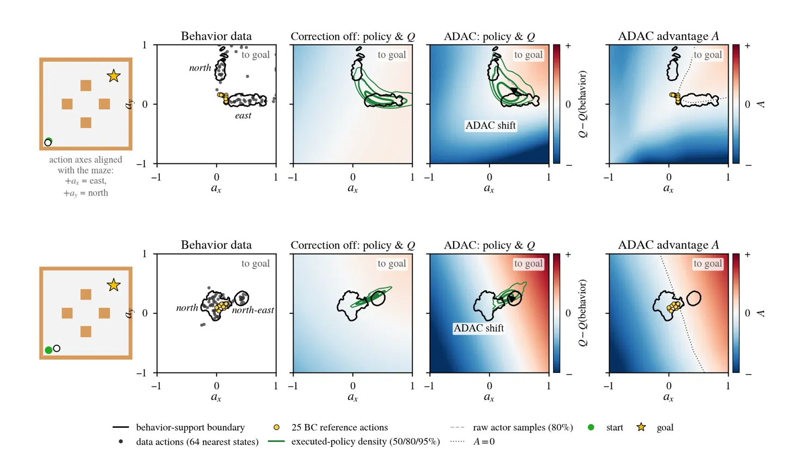

# ADAC rebuttal materials

## Empirical PointMaze action values

The figure shows two query states. The columns show offline actions, the policy and critic with the correction off, the ADAC policy and critic, and ADAC's quantile advantage. The action axes are aligned with the maze.

